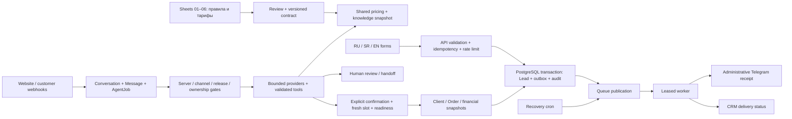

# Инфраструктура и потоки — 01.11.2026

Доказательства: [service-baseline.json](evidence/service-baseline.json), [inventory.json](evidence/inventory.json), [Neon protection](evidence/neon-protection.json), [effective AI](evidence/effective-ai.json). Здесь нет credentials, customer records или connection strings.

## GitHub и рабочая копия

- Репозиторий: [boooobly/lumaclean](https://github.com/boooobly/lumaclean), main `22b58184e0fdb0242ec5d2ae9d0e3b8850411fa2`.
- Production release metadata: `544da114d0a129e9dd9c0f73c047a574af776fd6`, release branch `codex/public-pages-release-20261027`. Remote branch уже на `574d0550682032f0c7bbc129cb20f924f2f34996`: дополнительный commit отчёта/QA, application inputs те же.
- Аудит: локальная копия `upholstery-premium`, ветка `codex/full-product-audit-20261101`, основание `574d055`. Другие самостоятельные копии не синхронизировались и чужие незакоммиченные правки не переносились.
- Список GitHub branches сохранён в service-baseline. Дополнительно получены все доступные branch refs; ancestry списки — локальные `branches-contained-main.txt` / `branches-contained-release.txt`. Main protection/check enforcement выключены. Никакие ветки не удалялись.

## Vercel

Team `team_cwlPNVZFs6PwR6BhDE7gU1eq`.

| Проект | ID / последний deployment | Фактическая роль |
|---|---|---|
| lumaclean | `prj_Q4nkQeWNwBIFz1AsthDvyEeJ5BeZ`; `dpl_3xJJgmzsGJG79fp2Jtsin7fKVEHH` | READY, production, Node 24.x, iad1; custom domains lumacleanrs.com/www |
| lumaclean-release-candidate | `prj_Dzc8yXL61u8r8vmKewjRtK9ZrTdk`; `dpl_2bYKSFAmTRgJV7QSABUz48hiihC4` | READY, target staging, live=false; metadata не даёт Git SHA |
| lumaclean-sofija-preview | `prj_QfCmCZlsGYr2EcdRy21dlPNNGKor`; `dpl_2M6wERkxyNw2M7QHrkQ1z5MtWq16` | READY, target=null, live=false; metadata не даёт Git SHA |

SSO protection: all_except_custom_domains. READY означает завершённый deployment, не успешную проверку функций. Эти старые Preview **не сертифицированы текущим аудитом**. Нового Preview не публиковали: изоляция env/получателей ещё не доказана. Автодеплой именно audit-ветки отключён в её vercel.json до проверки среды.

Production URL: [lumacleanrs.com](https://lumacleanrs.com). Проверенный deployment identity: [production deployment](https://lumaclean-9n6g1f3u3-vladislavs-projects-0eae0ea3.vercel.app). Это текущий baseline, не URL исправленной audit-сборки.

Опубликованный vercel.json содержит два queue/v2beta triggers: `lumaclean-notifications`, `lumaclean-agent`, retryAfterSeconds=200; workers visibility=240s, function maxDuration=180s. Cron `/api/agent/recover`: `0 6 * * *`, то есть 06:00 UTC (07:00 в UTC+1 на дату аудита). Регистрация/успешное исполнение scheduler отдельно не подтверждены. Drains отсутствуют.

## Neon / PostgreSQL

| Проект | Назначение / ограничения |
|---|---|
| `patient-butterfly-42300600` / lumaclean-admin | AWS us-east-1, PostgreSQL 18; main `br-noisy-bar-b8vmyqyi`, default/primary, около 38 MB; PITR history 21600 s |
| `fancy-firefly-98606053` / lumaclean-sofija-preview-20261029 | отдельный preview project, AWS us-east-1, PostgreSQL 18; не доказательство готовности voice |

Main: protected=false, но provider запрещает delete/delete-rw-endpoint/move-rw-endpoint по причине Vercel production branch. Allowlist пустой, block_public_connections=false. Это метаданные защиты, не вывод о доступе без пароля. SQL connector использует owner-role; runtime application role не удалось независимо подтвердить.

Branches основного проекта: main; homepage-focused-ux-test; release-candidate; pricing-update (archived); website-chat-v2-preview (archived); preview (archived); development (archived); pre-pr25 backups от 20/21 октября; pr25 rehearsal. Подробные ID и ancestry сохранены в JSON. Test branches созданы parent-data; наличие/санитизация PII требуют отдельного допуска перед использованием. Ничего не удалено/не сброшено/не разбужено для write-тестов.

Sensitive Vercel DATABASE_URL не раскрыт connector API. Provider main restriction подтверждает Vercel production role этой ветки, но независимое сравнение **точной** deployed connection host/branch/db не выполнено. Перед любым remote test/write это обязательный gate.

Локальная лаборатория: `127.0.0.1:55449`, PostgreSQL 17.11, data_directory внутри `upholstery-premium/artifacts/release-readiness/pgdata`. Отдельные admin/bootstrap/migration/reliability/ai test databases, только synthetic fixtures. Существовавшие тестовые БД сохранены переименованием. Локальная версия PG17 против remote PG18 — ограничение переносимости, а не PASS production migration rehearsal.

## Env requirements — только имена и назначения

| Группа | Переменные / контроль |
|---|---|
| DB/auth | DATABASE_URL pooled; DIRECT_URL direct; BETTER_AUTH_URL exact origin; BETTER_AUTH_SECRET |
| Internal Telegram | TELEGRAM_BOT_TOKEN, TELEGRAM_CHAT_ID, TELEGRAM_HANDOFF_WEBHOOK_SECRET; не смешивать с customer bot |
| Customer channels | TELEGRAM_CUSTOMER_*, WHATSAPP_ACCESS_TOKEN/APP_SECRET/PHONE_NUMBER_ID/BUSINESS_ACCOUNT_ID/VERIFY_TOKEN/GRAPH_VERSION, VIBER_CUSTOMER_* |
| AI | AI_AGENT_ENABLED; PRIMARY/FALLBACK_AGENT_MODEL/PROVIDER; POYO_API_KEY, OPENROUTER_API_KEY; budget/rates |
| Certification | AI_VERIFIED_RELEASE/source fingerprint вычисляет Next config из release evidence; AI_LIVE_TEST_SECRET, AI_LIVE_TEST_PREVIEW_URL, AI_LIVE_TEST_DATABASE_HOST |
| Storage | BLOB_READ_WRITE_TOKEN, CHAT_STORAGE_NAMESPACE; общий токен по target требует namespace boundary proof |
| Routing | LUMACLEAN_ROUTING_PROVIDER/URL/TOKEN, LUMACLEAN_GOOGLE_ROUTING_ENABLED, GOOGLE_MAPS_SERVER_API_KEY, BUSMAPS_STATUS/API_KEY/limit |
| Recovery | CRON_SECRET; scheduler source и external invocation proof |
| Analytics | NEXT_PUBLIC_YM_COUNTER_ID, NEXT_PUBLIC_GA_MEASUREMENT_ID, consent state |

Наличие ключа не доказывает корректное значение или работоспособность provider. .env/значения не копировались в отчёт. Локальные runners очищают dotenv/provider/notification ключи и используют loopback URL.

## Потоки и точки отказа

Lead сохранён, Queue publish упал: outbox должен пережить ответ и попасть в recovery. Worker получил timeout после возможного Telegram send: UNKNOWN, автоматического retry нет. Conversation изменена оператором/kill switch: revision/lease/live settings проверяются перед эффектами. Модель не имеет произвольного SQL или arbitrary client-ID доступа. Длительность/маршрут/слот/цена заново проверяются на booking boundary.

## Реально используемое / историческое / неполное

- Существующие сайт/CRM/outbox/queues/Website chat присутствуют в deployed baseline и имеют локальные HTTP/DB проверки. Это одна система, новая параллельная CRM/очередь не добавлена.
- Current Website AI effective OFF: owner подтвердил dynamic server hint; DB mode AUTO оставлен. Telegram/Viber/WhatsApp AI modes OFF по read-only settings. Это не утверждение, что все messenger webhooks/уведомления отключены: их switches независимы.
- Upholstery legacy API остаётся для совместимости; новый публичный путь может вести через общий `/api/lead`. Удаление legacy consumers без отдельной проверки запрещено.
- Voice/ElevenLabs PR #31 — staging-only, не main/production feature. Реальные phone assignments, провайдерский account, звонки и pronunciation не проверены.
- Routing gateway/MOTIS/BusMaps/Google представлены кодом/config; внешний live routing и account permissions не сертифицированы. Карта не доказывает live routing.
- Railway plugin inventory был запрошен, но connector не вернул project data (error); состояние routing host/account этим аудитом не подтверждено.
- Main/release/AI knowledge reports с прежними датами исторические. `docs/production-release-2026-10-31.md` точно описывает тот выпуск, но не подтверждает текущие local changes.
